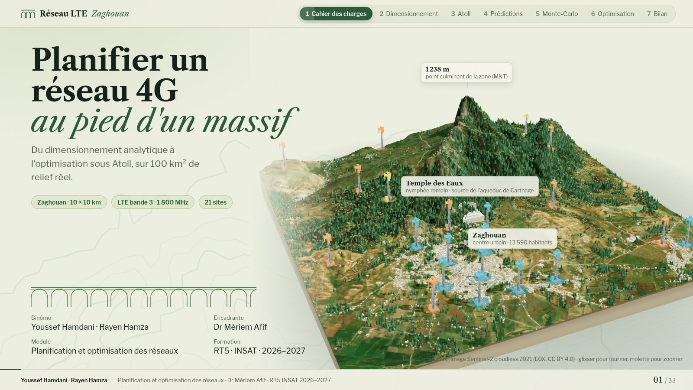
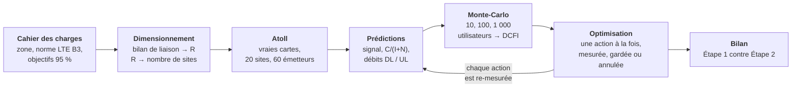
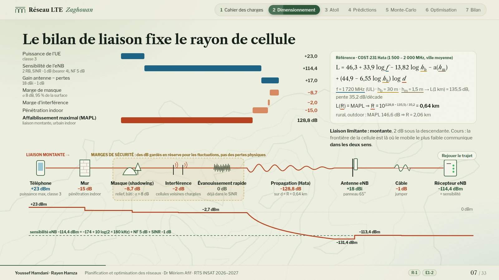
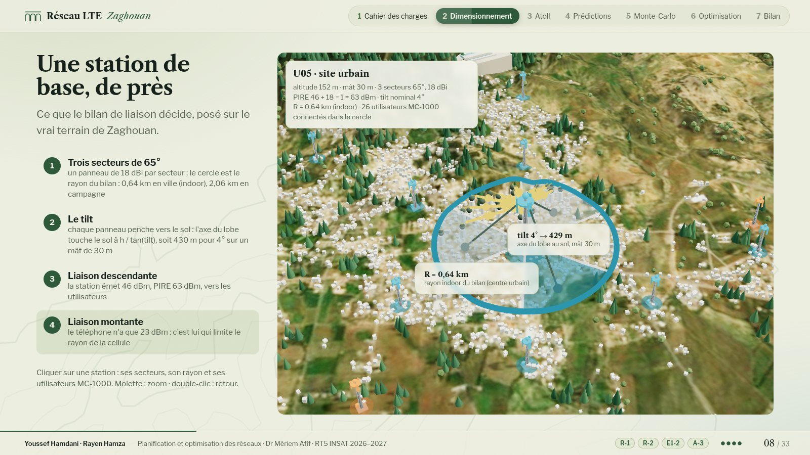
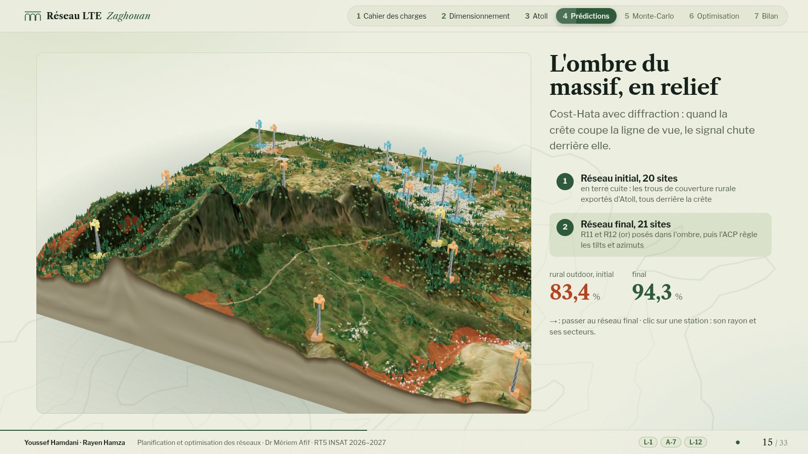
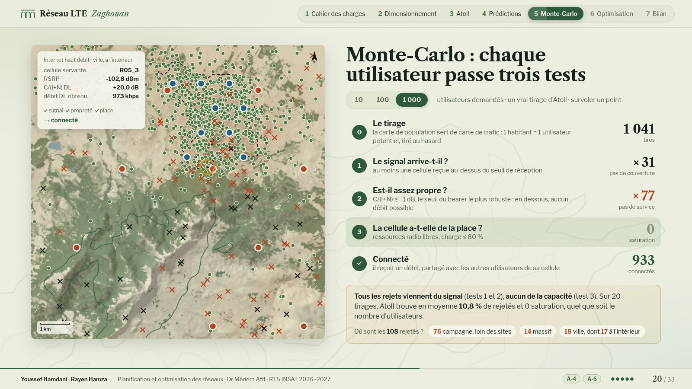
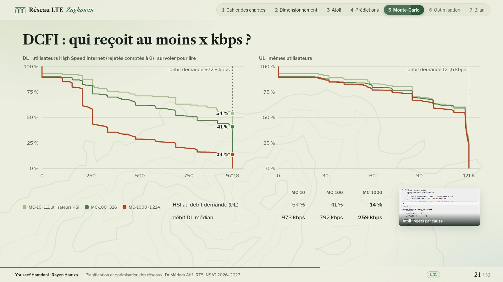
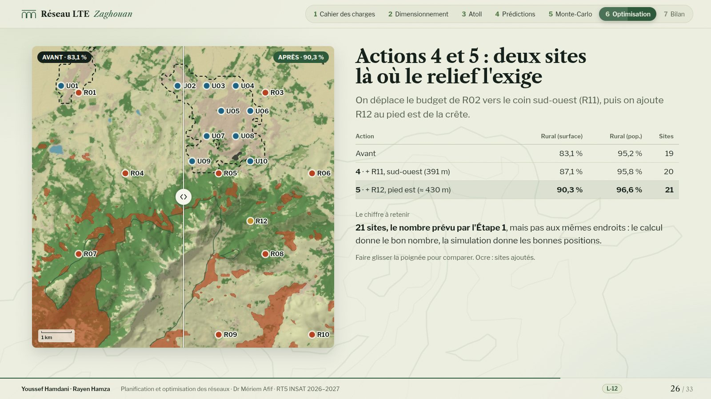
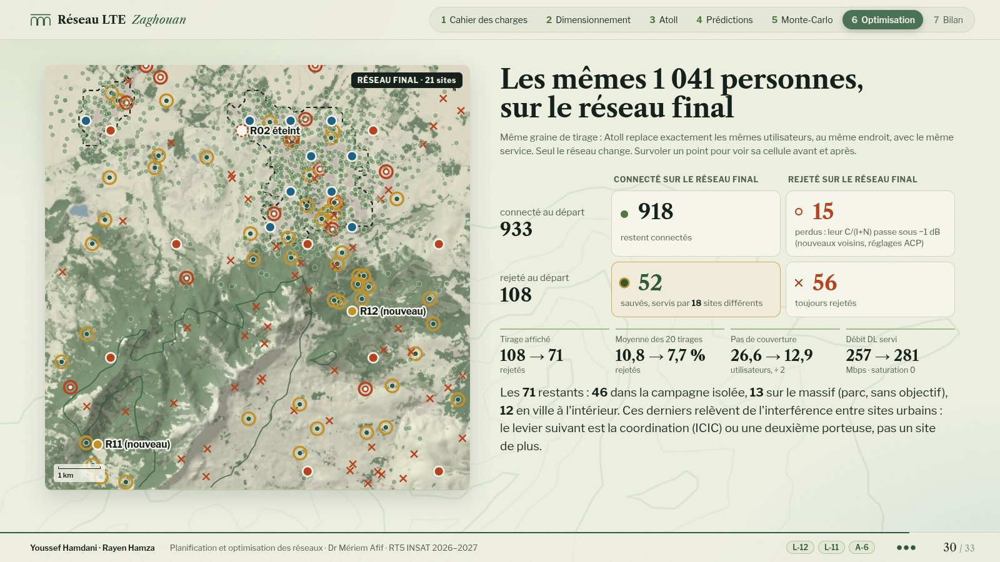
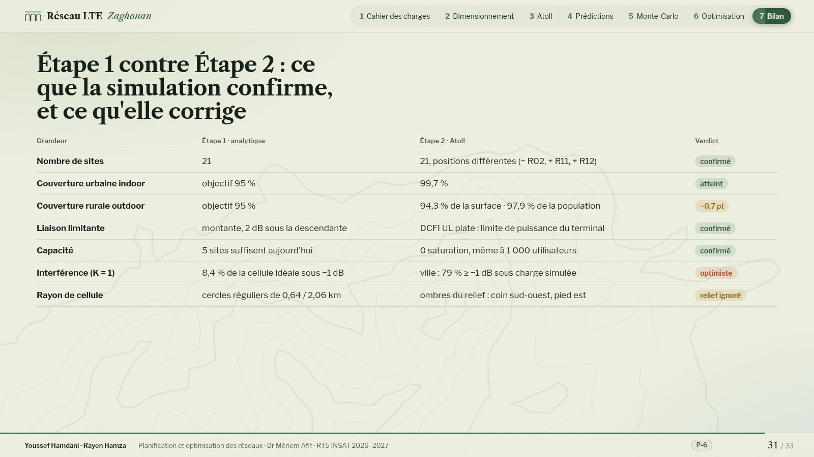

<div align="center">

# Réseau LTE Zaghouan

**Planifier un réseau 4G au pied d'un massif : du calcul analytique à l'optimisation sous Atoll**

*Planning a 4G network at the foot of a mountain in Tunisia: analytical dimensioning, Atoll simulation and optimisation, on 100 km² of real terrain.*


Mini-projet 1 · **Planification et optimisation des réseaux** · RT5 · INSAT (Université de Carthage) · 2026–2027
Binôme : **Youssef Hamdani · Rayen Hamza** · Encadrante : **Dr Mériem Afif**

### [▶ Ouvrir la présentation en ligne](https://jozziiff.github.io/Atoll-Project-Zaghouan/) · [📄 Lire le rapport (PDF)](06-rapport/Rapport_LTE_Zaghouan.pdf)

</div>



<sub>La première diapo. Le relief est le vrai modèle de terrain (Copernicus, 25 m), la forêt suit la vraie carte d'occupation du sol, chaque pylône est un site du réseau final : <b>bleu</b> = urbain, <b>terre cuite</b> = rural, <b>or</b> = ajouté pendant l'optimisation. On y voit aussi le Temple des Eaux, la source romaine de l'aqueduc de Carthage.</sub>

---

## Le projet en 30 secondes

Un opérateur veut couvrir **Zaghouan et sa campagne** (10 × 10 km, 25 359 habitants) en 4G.
Nous avons joué le rôle de l'ingénieur planification radio :

1. **Calculer** à la main combien de stations il faut, et où (le *dimensionnement*).
2. **Construire** ce réseau dans le logiciel professionnel **Atoll**, sur le vrai relief.
3. **Mesurer** ce qu'il donne : couverture, débits, et des milliers d'utilisateurs simulés.
4. **Optimiser** : une action à la fois, mesurée avant / après, gardée ou annulée.
5. **Comparer** honnêtement le calcul et la simulation.

> **Le résultat en une phrase :** le calcul analytique a donné le bon nombre de sites (21), la simulation a donné les bons emplacements, et chaque décision d'optimisation a été mesurée avant d'être gardée.

## Les chiffres clés

| | Avant optimisation | **Réseau final** | Objectif |
|---|---|---|---|
| Couverture de la ville (à l'intérieur des bâtiments) | 99,5 % | **99,7 %** | 95 % ✅ |
| Couverture de la campagne (en extérieur) | 83,4 % | **94,3 %** (97,9 % des habitants) | 95 % (−0,7 pt) |
| Utilisateurs rejetés, simulation à 1 000 utilisateurs | 10,8 % | **7,7 %** | |
| Débit descendant total servi, 1 000 utilisateurs | 257 Mbps | **281 Mbps** | |
| Nombre de sites | 20 (grille de l'Étape 1) | **21** | 21 prévus par le calcul |

## La démarche



**Une seule chaîne, du début à la fin :** même zone, même bande, même modèle de propagation (COST-231 Hata), mêmes hypothèses de trafic. C'est ce qui rend la comparaison finale possible.

---

## Ce que montre la présentation

### 1. Le bilan de liaison fixe la taille des cellules



On suit **un seul signal**, du téléphone (+23 dBm) jusqu'à la station. On retire le mur, les marges de sécurité (effet de masque, interférence), puis la propagation calculée par **COST-231 Hata**. Le signal arrive exactement au seuil de la station (−114,4 dBm) à **0,64 km** en ville et **2,06 km** en campagne. Le sens montant (téléphone → station) est le plus faible : c'est lui qui fixe la taille de la cellule.

### 2. Une station de base, de près



Trois secteurs de 65°, le cercle du rayon calculé, le **tilt** (l'inclinaison des antennes) et de vrais utilisateurs simulés, reliés à la station en descendant (DL) et en montant (UL).

### 3. Le relief crée des zones d'ombre



Les zones non couvertes (en rouge, exportées d'Atoll) sont **toutes derrière la crête**, là où le signal ne passe pas. Les deux sites ajoutés (en or) sont posés **dans l'ombre**, parce qu'aucune station extérieure ne peut passer la montagne.

### 4. Monte-Carlo : chaque utilisateur passe trois tests



Atoll place des utilisateurs là où vivent les gens, puis teste chacun : **le signal arrive-t-il ?** **est-il assez propre ?** **la cellule a-t-elle de la place ?** Tous les rejets échouent aux deux premiers tests, aucun au troisième : le réseau manque de **signal** à certains endroits, pas de **capacité**.

### 5. La DCFI : qui reçoit quel débit ?



Pour 10, 100 et 1 000 utilisateurs, la part des utilisateurs qui reçoivent au moins un débit donné. Le débit descendant baisse avec la charge (973 → 259 kbps médians) ; le débit montant ne bouge pas : il est limité par la puissance du téléphone, comme le calcul l'annonçait.

### 6. Optimiser, une action à la fois



Neuf essais, chacun mesuré : **gardés** : incliner davantage les antennes de la ville, éteindre un site inutile (R02), ajouter deux sites dans l'ombre (R11, R12), laisser l'outil **ACP** d'Atoll régler 63 secteurs ; **rejetés**, mesures à l'appui : déplacer R07, tourner ses antennes, incliner encore plus la ville ; puis les listes de voisins (**ANR**). Campagne : **83,4 → 94,3 %**.

### 7. La preuve sur les mêmes personnes



Même tirage aléatoire, même graine : Atoll replace **exactement les mêmes 1 041 utilisateurs** sur le réseau final. 52 rejetés sont sauvés, 15 sont perdus (l'interférence se déplace), bilan net **108 → 71**.

### 8. Le calcul contre la simulation



Ce que la simulation **confirme** (nombre de sites, liaison limitante, capacité) et ce qu'elle **corrige** (positions des sites, interférence en ville, effet du relief que la formule de Hata ignore).

---

## Correspondance avec le sujet

Chaque livrable demandé par le sujet et où le trouver. **L-1 … L-12** numérotent, dans l'ordre, les livrables Atoll du § 4.2 ; **P-1 … P-6** les points attendus dans la présentation (§ 5). Ces repères sont écrits en bas de chaque diapo.

| Livrable | Contenu | Diapo | Fichiers |
|---|---|---|---|
| L-1 · L-2 · L-3 | Couverture par niveau de signal + histogramme + légende | 14 (et C/(I+N) : 17) | `04-atoll/exports/L-01*`, `L-02*` |
| L-4 · L-5 · L-6 | Couverture par émetteur, recouvrement + histogramme + légende | 16 | `L-04*`, `L-05*` |
| L-7 · L-8 · L-9 · L-10 | Débits DL et UL + légendes, comparés aux débits cibles | 18 – 19 | `L-07*`, `L-08*` |
| L-11 | DCFI 10 / 100 / 1 000 utilisateurs sur un même graphique | 20 – 22 | `L-11_DCFI*.png`, `dcfi.md` |
| L-12 | Optimisation : avant / après et justification pour chaque action | 23 – 30 | `trous_couverture_*`, `couverture_zones_*.md` |
| P-1 | Rappel du cahier des charges | 2 – 5 | `01-cahier-des-charges/` |
| P-2 | Dimensionnement : bilan de liaison, rayon, nombre de sites | 6 – 12 | `02-dimensionnement/` |
| P-4 | Synthèse DCFI et impact sur la capacité | 22 | |
| P-5 | Démarche d'optimisation, avant / après | 23 – 30 | |
| P-6 | Conclusion critique : écarts Étape 1 / Étape 2, limites | 31 – 32 | |

## Structure du dépôt

```
├── 01-cahier-des-charges/   zone, norme, objectifs, hypothèses (chaque valeur avec sa source)
├── 02-dimensionnement/      calc.py + params.py → resultats.md et figures (Étape 1)
├── 03-cartes/               relief, occupation du sol, population pour Atoll + script de fabrication
├── 04-atoll/                projet Atoll (.ATL), captures d'écran, exports (cartes, histogrammes, Monte-Carlo)
│   └── exports/             tous les livrables L-1 … L-12, nommés par livrable
├── 05-presentation/         la présentation (un seul fichier HTML) et ses sources
│   ├── Presentation_LTE_Zaghouan.html   ← à ouvrir
│   └── deck/                sources : HTML, CSS, JS, données
├── 06-rapport/              le rapport : Rapport_LTE_Zaghouan.pdf et ses sources LaTeX
└── docs/img/                images de ce README
```

## Ouvrir la présentation

- **En ligne :** [jozziiff.github.io/Atoll-Project-Zaghouan](https://jozziiff.github.io/Atoll-Project-Zaghouan/)
- **Hors ligne :** télécharger [`05-presentation/Presentation_LTE_Zaghouan.html`](05-presentation/Presentation_LTE_Zaghouan.html) et l'ouvrir dans Chrome, Edge ou Firefox. Un seul fichier, rien à installer.

| Touche | Action |
|---|---|
| → / Espace | étape suivante (beaucoup de diapos se construisent en plusieurs temps) |
| ↓ / ↑ | diapo suivante / précédente |
| F | plein écran |
| N | notes de l'orateur |
| souris | faire tourner la 3D, survoler les cartes et les courbes, cliquer sur une station |

## Refaire les calculs

```bash
python3 -m venv .venv && .venv/bin/pip install numpy matplotlib gdal markdown
.venv/bin/python 02-dimensionnement/calc.py              # Étape 1 → 02-dimensionnement/resultats.md
.venv/bin/python 04-atoll/dcfi.py                         # DCFI depuis les exports Monte-Carlo d'Atoll
.venv/bin/python 05-presentation/build_assets.py          # données et cartes de la présentation
.venv/bin/python 05-presentation/build_single.py          # présentation en un seul fichier
```

Les téléchargements bruts (174 Mo) ne sont pas dans le dépôt ; `03-cartes/README.md` explique comment les récupérer. Les cartes prêtes pour Atoll, elles, sont incluses dans `03-cartes/atoll/`.

## Données et crédits

- **Relief :** Copernicus GLO-30 DEM (© DLR / Airbus, distribué par l'ESA).
- **Occupation du sol :** ESA WorldCover 2021, 10 m (CC BY 4.0).
- **Population :** WorldPop 2020 (CC BY 4.0).
- **Image satellite de la 3D :** Sentinel-2 cloudless 2021 par EOX (CC BY 4.0), contient des données Copernicus Sentinel modifiées (2021).
- **Trafic :** rapport de l'INTT (Tunisie), tableau de bord TR4-2025.
- **Logiciel :** Atoll 3.3 (Forsk). Visualisations : three.js.

Travail réalisé dans le cadre du module *Planification et optimisation des réseaux* de Dr Mériem Afif, INSAT, 2026–2027.
